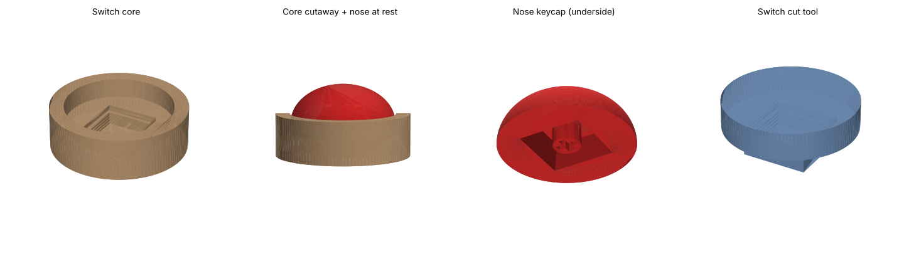

# Cute Rudolph Clicker

A cuter Rudolph fidget clicker: a hi3d-generated head with a red-nose keycap
on one MX-style mechanical switch.



## Parts

| File | What it is |
| --- | --- |
| `fusion360/RudolphClickerCore/` | Fusion 360 script that builds the switch core, nose keycap and switch cut tool as parametric bodies |
| `stl/switch_core.stl` | 36 × 15 mm puck that holds the switch (same dimensions as the Fusion script) |
| `stl/nose_keycap.stl` | 28 mm red-nose dome keycap with an MX cross stem |
| `stl/switch_cut_tool.stl` | Negative of the switch pocket, to cut into any other head |
| `tools/build_core.py` | Rebuilds the three STLs above without Fusion |
| `tools/merge_head.py` | Fuses a hi3d head (GLB/STL) with the core and cuts the switch pocket |

The pocket dimensions come from the original Rudolph Clicker body and the
Mechanical Switch Keycap Fidget Clicker Template:

- 0.4 mm floor with a 4.2 mm centre-post hole, plus pin and PCB-post holes, so
  3- and 5-pin switches drop in without clipping the legs
- 14 × 14 mm bottom-housing pocket, then a 15.6 mm clip groove from 5.0 to 6.6 mm
- 1.4 mm plate with the standard 14 × 14 mm MX cutout (top at 8.0 mm)
- 28.5 mm recess for the 28 mm nose keycap

## Fusion 360

1. Go to **Utilities → Add-Ins → Scripts and Add-Ins**, click **+** next to
   *My Scripts*, and choose the `fusion360/RudolphClickerCore` folder.
2. Select **RudolphClickerCore** and click **Run** (an empty design works).
3. Tune the fit under **Modify → Change Parameters**. Useful ones:
   `cutout_w` / `plate_t` if the switch is loose or will not clip in,
   `cross_l` / `cross_w` if the keycap is loose or too tight on the stem,
   `recess_d` for nose clearance.
4. To build the head in Fusion: **Insert → Insert Mesh** the hi3d model,
   convert it to a solid (**Mesh → Modify → Convert Mesh**), move the
   *Switch Cut Tool* under the nose, then use **Modify → Combine → Cut**.
5. Right-click each body and choose **Save As Mesh** to export STL/3MF.

## hi3d head

hi3d makes 3D models from images, so the head takes two steps: a 2D concept
image, then image-to-3D.

**Image prompt:**

> Cute chibi Rudolph the reindeer head, front view, flat relief medallion for a
> 3D-printed fidget toy: big round glossy eyes, rosy cheeks, small happy smile,
> soft round face, short chunky rounded antlers, little ears, large empty round
> socket in the middle of the snout where the red nose goes. Simple smooth
> shapes, no thin parts, plain light background, toy figurine style.

**3D settings:** v3.0 high quality, model only (it is printed in solid colours),
private licence. Get a free quote first.

**Merge:**

```bash
python3 tools/merge_head.py cute_rudolph.glb --width 80 --nose-x 0 --nose-y -18 --preview
```

Check the PNG it writes and adjust `--nose-x/--nose-y` until the core sits
under the snout socket.

## Printing

- Body: PLA, 0.2 mm layers, face up on the bed; no supports needed for the pocket.
- Nose: red PLA, flat side down on the bed.
- Press a switch in from the top until the clips snap, then push the nose on.
- If the switch clips do not catch, print a test core first and adjust
  `plate_t` (1.2–1.5 mm) or `cutout_w` (13.9–14.1 mm).
